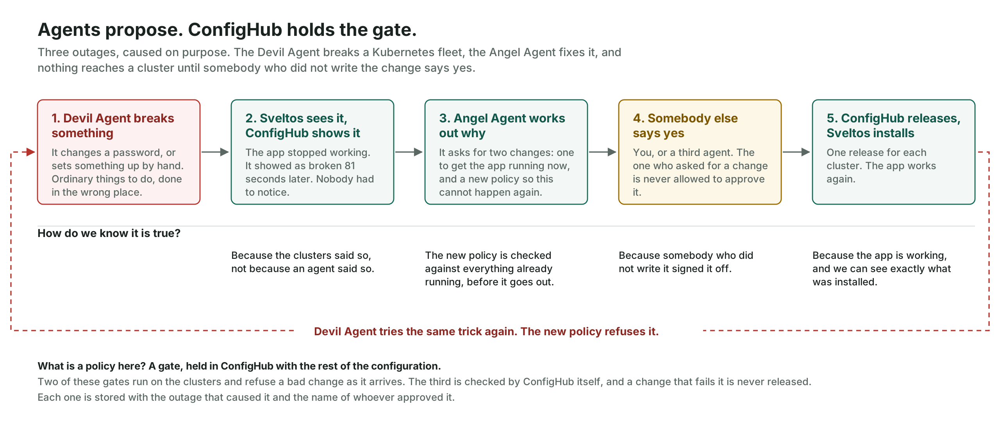

# AI chaos in production

**Status:** draft. Not yet published.
**Demo:** [`demo/`](../../demo/README.md) in this repository. Everything in the post can be run.

Three outages on a Kubernetes fleet, caused on purpose by one AI agent and repaired by another.
Each repair comes in two parts: a fix for what broke, and a policy that stops it happening
again. Nothing takes effect until somebody who did not write it approves.

Sveltos and ConfigHub do three jobs here at once: **fleets**, **compliance** and **agentic
operations**. Sveltos delivers each cluster's configuration and reports its health. ConfigHub
holds the configuration, the policies, and the record of every change and approval.

**The workloads** are a small web application, `api` and `web`, plus one platform component.
Nothing depends on the workload being an application: the same pattern carries platform
components and GPU stacks, as
[`examples/gpu-operator`](../../examples/gpu-operator/README.md) shows.

**Outage 3 is a repaving example**, and the one to lead with. The prod clusters are rebuilt from
nothing overnight, which is the repave of the three Rs. Everything should come back from the
source of truth. Two things do not, and both failures are silent.

## What is in this folder

| File | What it is |
| --- | --- |
| [`intro.md`](intro.md) | The whole story at a walking pace, for a reader who has read nothing else of ours |
| [`agent-guide.md`](agent-guide.md) | For a reader's own AI agent: how to answer questions about the post, and how to reproduce it |
| [`captions.md`](captions.md) | The three screenshots, where each lives, and what to notice |
| [`diagram.svg`](diagram.svg), [`diagram.png`](diagram.png) | What happens each time something breaks |

## Where to start

Read [`intro.md`](intro.md). To run it, go to [`demo/README.md`](../../demo/README.md).
