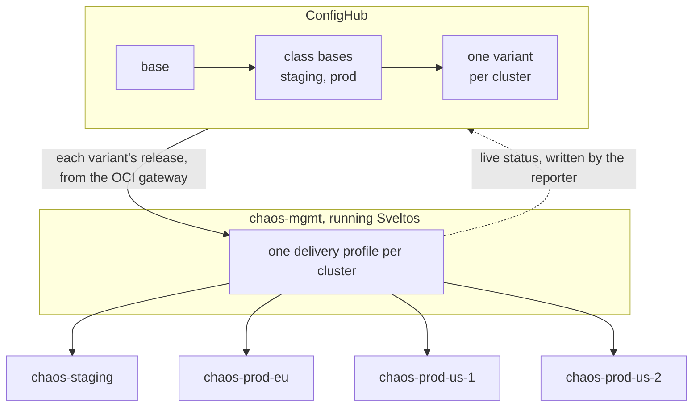

# AI chaos in production: run it yourself on K8s

A demonstration of the 'chaos' approach to testing a production fleet
using AI with a sveltos-confighub layer on standard K8s. The idea is
that a 'devil' chaos agent causes problems but these are remedied by
an 'angel' agent, and then a 3rd party (AI or human) does approvals.

Each time, the angel proposes two changes, and neither takes effect
until it is approved: a fix for the configuration that caused the
outage, and a rule that stops the same failure happening again. In
this demo we have three outages: in both 1 and 2 that new rule is an
admission policy; in outage 3 it is a gate that ConfigHub itself checks on
every change, which the approver turns on.

By using ConfigHub we get the advantage of a single operational database
for configuration and facts. So the demo is a simple set of compliance
apps. The config data is combined with a policy engine (you choose which
one) for this.

## At a glance

- **What you will see.** Three outages on a fleet of kind clusters standing in
  for production. An agent causes each one. The fleet's own health checks show
  it in ConfigHub. Another agent fixes it through ConfigHub's approval gates,
  then proposes a rule that stops it happening again.
- **What it takes.** A Mac, Docker with room for six kind clusters, a ConfigHub
  organization where you are an admin, and Claude Code. About two to three
  hours, and $20 to $30 of model time with `MODEL=claude-opus-5-5`.
  [What you need](#what-you-need) has the detail.
- **Where to start.** [Stand it up](#stand-it-up), then onboard the fleet
  ([scenarios/00-onboard.md](scenarios/00-onboard.md)), then run the three
  outages in order.
- **What has been run.** The agents ran onboarding and outages 1 and 2 end to
  end twice, on 3 October 2026 ([diary/](diary/README.md)). Outage 3, the
  nightly repave, replaced an earlier outage 3 on 26 October 2026. Each of its
  pieces was run and checked by hand that day. The agents have not run it yet.

Summary: there are three outages on a Sveltos fleet, each caused on purpose,
and fixed through ConfigHub, and then prevented through ConfigHub. This is
orchestrated by some AI agents each with their own ConfigHub identities:

- **Devil** causes each outage the way it happens in real life.
- **Angel** finds the cause, fixes it through ConfigHub, and proposes what
  stops it recurring.
- **Milton** reviews and approves, if you let it.
- **You** approve by hand at any step, or leave it to Milton.

NOTE: Neither Devil nor Angel can approve. Milton can approve. Or a human.
NOTE: In this demo version, kind clusters are 'standing in' for production.

| Outage | What breaks | What prevents it |
| --- | --- | --- |
| [1. A rotation nobody picked up](scenarios/01-rotation.md) | A Secret rotated outside ConfigHub; `web` keeps the old token on every cluster | Admission policy: a workload that takes a Secret from its environment must say how it picks up a rotation |
| [2. Half the fleet at once](scenarios/02-blast-radius.md) | A ClusterProfile applied by hand blocks the shop on the two `region=us` clusters | Admission policy on the management cluster: profiles come only from the record |
| [3. The nightly repave](scenarios/03-repave.md) | The prod clusters, rebuilt from nothing overnight, come back without the shop: Sveltos delivers nothing, and the shop's hand-made token is gone | A gate ConfigHub checks on every change: what a workload uses, the release holds or makes. The repave job asks Sveltos to deliver again |

[PROOF.md](PROOF.md) lists each claim and where to check it, in the CLI and
the web UI. [diary/](diary/README.md) tells the two recorded runs as they
happened, with screenshots and the agents' own commands:
- [the first run](diary/first-run.md), with a person approving;
- [the verification run](diary/verification-run.md), made from this README with
  Milton approving everything. There Milton refused the change behind that
  run's outage 3.

Both runs had an earlier outage 3, "staging said yes, prod said no": a memory
limit cut in prod only. On ConfigHub v0.9.5 a change made only in a prod Space
is no longer released by the rollout on its own, so that outage could not be
staged as written, and the repave replaced it. Its scenario is in this
directory's history. [recording/](recording/README.md) has the first run's
transcripts, and ConfigHub's record of both runs.

## How the pieces fit



- **ConfigHub** holds each cluster's configuration as a variant, cloned from a
  class base, cloned from a base. A change goes base first, then staging, then
  prod, and each release waits for an approval.
- **Sveltos**, on the management cluster `chaos-mgmt`, fetches each variant's
  latest release from ConfigHub's OCI gateway and applies it to that one
  cluster. The delivery profiles that do this are themselves released from
  ConfigHub, from the record.
- **The reporter** reads what Sveltos delivered and how the workloads are, and
  writes it into ConfigHub as live status every 15 seconds.
- **The agents** work with `cub` and `kubectl`, each as its own ConfigHub
  identity. Milton, or you, approves in ConfigHub.

## The words used here

| Word | What it means here |
| --- | --- |
| **Space** | A ConfigHub folder of configuration, one per base, class base or cluster. The demo's are named `chaos-*` |
| **Unit** | One piece of configuration in a Space, with every revision kept: here the shop's manifests (`shop`), Reloader's (`reloader`), or a policy (`guardrails`) |
| **Base, class base, variant** | The shop's configuration in `chaos-shop-base`, cloned into a class base for staging and one for prod, then into one variant per cluster (`chaos-shop-staging`, `chaos-shop-prod-eu`, ...). The web UI shows each variant as a deployment |
| **Change order** | One named change, followed through a workflow. Written `<base Space>/<name>`, for example `chaos-shop-base/web-reload-on-token-rotation` |
| **Workflow, stage** | The path a change order takes: `bases`, then `staging`, then `prod`. Each stage may need approvals before its release |
| **Release** | What ConfigHub publishes for a variant, and what Sveltos fetches and applies to that cluster |
| **Attestation** | A recorded verdict on a change: an Approval by you or Milton |
| **Trigger** | A function ConfigHub runs on every change to a unit. A validating one that fails blocks the unit's release |
| **The record** | The management cluster's Space, `chaos-management`. Its releases deliver every Sveltos delivery profile, so profiles come from ConfigHub, not by hand |
| **Live status** | What each cluster reports, written into ConfigHub every 15 seconds: Synced or not, Healthy or Degraded. The web UI shows Healthy as Live |
| **The shop** | The demo's app: `api` and `web` in namespace `shop`, Python on `python:3.12-alpine`. Its code is the ConfigMap `shop-code`, and its API token the Secret `shop-token`, made by hand in each cluster |
| **Reloader** | Stakater Reloader, which restarts the pods that use a Secret when it changes. The demo's platform component, `chaos-platform` |
| **Sveltos** | The add-on manager that delivers configuration from the management cluster to the workload clusters |
| **Management cluster** | `chaos-mgmt`, where Sveltos runs. The workload clusters are `chaos-staging`, `chaos-prod-eu`, `chaos-prod-us-1` and `chaos-prod-us-2` |
| **SveltosCluster** | Sveltos's registration of a workload cluster, with its labels: `env` (staging or prod) and `region` (eu or us) |
| **Delivery profile** | A Sveltos ClusterProfile that fetches one variant's release and applies it to its one cluster |
| **ClusterSummary** | Sveltos's record of what one profile delivered to one cluster |
| **Promote** | Move a change order into its next stage. The stage's variants take the change; nothing is released yet |
| **Baseline** | A variant's first release, published during onboarding: what its cluster already ran |
| **Handover** | The onboarding step that moves delivery from the profiles you applied by hand to ConfigHub's releases |
| **Service account** | A ConfigHub identity for something that is not a person. Each agent is one |
| **Policy sandbox** | A kind cluster that holds admission policies and nothing else, where a policy is previewed before it ships |
| **Command sandbox** | Claude Code's macOS sandbox, which holds every command an agent runs |
| **Restore list** | Outage 3's list of what a repave brings back of the shop, which ConfigHub checks on every change |

## Which policy engine

A policy does three jobs here, and the choice of engine matters differently
to each:

| Job | In this demo | With Kyverno or OPA Gatekeeper instead |
| --- | --- | --- |
| **Enforce** the rule on the clusters | Kubernetes' own admission control: ValidatingAdmissionPolicy, with rules written in CEL. Nothing extra runs on the clusters | Works the same way. A Kyverno policy or a Gatekeeper constraint is a unit like any other: ConfigHub holds it and releases it on approval, and Sveltos delivers it. Install the engine on the clusters first, as the demo installs Reloader |
| **Check** a change in ConfigHub before it is released | Outage 3's repave gate: ConfigHub's own `vet-starlark` and `where-filter` functions, run as triggers on every change | Kyverno: yes, through a worker running `vet-kyverno-server` (see [Check every change against your policies](../docs/user/policy-checks.md)). OPA: no ready-made check today. ConfigHub's own checks run CEL (`vet-cel`) or Starlark (`vet-starlark`) |
| **Preview** a new policy's effect before it ships | `cub sveltos impact`: server-side dry runs in the policy sandbox, a cluster that runs nothing else | Not yet. The preview reads ValidatingAdmissionPolicy verdicts only, and Kyverno and Gatekeeper run as workloads, which the sandbox must not |

So the demo does not bring an engine of its own: it uses the one built into
Kubernetes. You can enforce with Kyverno or Gatekeeper instead. What you give
up today is the preview, and with OPA, the check in ConfigHub. The guide's
[Which policy engine does what](../docs/user/policy-checks.md#which-policy-engine-does-what)
has the full picture, with ConfigHub's own checks.

## Tested on

The versions we used on 26 October 2026, when stand-up, onboarding, the
handover, the gates, live status and each piece of outage 3 were last checked:

| Product | Version |
| --- | --- |
| ConfigHub (hub.confighub.com) | server v0.9.5. The hosted server moves on: you get the version it runs |
| `cub` | v0.9.0. v0.8.13 or newer is needed, for service accounts |
| `cub sveltos` (this repository) | v0.15.0 or newer: from v0.15.0, Sveltos pulls releases as a service account |
| Sveltos | v1.16.0, installed by the fleet script |
| kind | v0.31.0 with Kubernetes v1.35.0 nodes. Before v0.31, kind does not enforce NetworkPolicy, and outage 2 needs it |
| Claude Code | 2.1.285, model `claude-opus-5-5` |
| Helm, which renders the charts | v4.1.4 |
| Stakater Reloader (Helm chart) | 2.2.18 |
| Also used | kubectl v1.36, Docker 29.4, Node.js 25, Python 3 with PyYAML |

The recorded runs of 3 and 4 October 2026 used ConfigHub v0.8.1 and v0.8.3,
`cub` v0.8.1, `cub sveltos` v0.13.0 and Sveltos v1.15.0, with the agents as
ConfigHub workers and no command sandbox. ConfigHub is removing workers.
[recording/check-2026-10-04.md](recording/check-2026-10-04.md) is the recheck
on v0.8.3.

## What you need

- **A Mac, for the agents' runs.** `agents/run-agent.sh` holds each agent in
  Claude Code's command sandbox, which works on macOS, and stops if the
  sandbox is not there. On Linux and WSL2 the sandbox gives a command a
  localhost of its own, so an agent's `kubectl` could not reach the kind
  clusters. The fleet, setup and the proof scripts run anywhere.
- **Docker, with room for six kind clusters**: the management cluster, four
  workload clusters and the policy sandbox. We used 18 cores and 48 GB, with
  33 GB given to Docker. On Linux, raise the inotify limits first, as
  [kind's docs](https://kind.sigs.k8s.io/docs/user/known-issues/#pod-errors-due-to-too-many-open-files)
  say for many clusters.
- **A ConfigHub organization** with 20 free Spaces, where you have the admin
  role. Setup creates 17 `chaos-` Spaces, service accounts with org roles, and
  components; Angel adds `chaos-policies` in outage 1. As an admin you can
  approve any change yourself. The scripts act through your current `cub`
  context. If it points at another organization, run
  `export CUB_CONTEXT=<your context>` in each terminal, setup and teardown
  included.
- **Claude Code**, signed in, 2.1.285 or newer. The demo runs about 35 agent
  sessions, some of them over 300 turns, so check your plan's limits. With
  `claude-opus-5-5` they cost us about $20 to $30 in all.
- **The rest:** `cub`, the `cub sveltos` plugin, kind, kubectl, Helm, Node.js,
  and Python 3 with PyYAML. `standup.sh --check` says which are missing.

Clone the repository, and check:

```bash
git clone https://github.com/confighub/sveltos-confighub && cd sveltos-confighub
bash demo/standup.sh --check
```

To install `cub` and the plugin at the versions above (ConfigHub's installer
takes a version, and puts `cub` in `~/.confighub/bin`):

```bash
curl -fsSL https://hub.confighub.com/cub/install.sh | VERSION=v0.9.0 bash
export PATH=$HOME/.confighub/bin:$PATH
cub auth login
cub plugin install confighub/sveltos-confighub@v0.15.0
```

## Stand it up

`source demo/env.sh` in every terminal you use. It sets:
- `$DEMO`, the demo directory;
- `$AI_CHAOS_DIR` (default `~/ai-chaos`), for the kubeconfigs, the onboarding
  output, the agents' identities and their runs;
- `$CHAOS_RUNS` (default `$AI_CHAOS_DIR/runs`), where each agent run is kept;
- `KUBECONFIG`, to one file with a context per cluster (`kind-chaos-mgmt`,
  `kind-chaos-staging`, `kind-chaos-prod-eu`, ...), in that terminal only;
- `YOU_ID` and `MILTON_ID`, once `setup/identities.sh` has written them.

From the repository's root:

```bash
bash demo/standup.sh                        # checks what it needs, then builds everything
source demo/env.sh
```

`bash demo/standup.sh --check` only checks for the tools, the sign-in and the
plugins. The full run takes about ten minutes. Running it again is safe: it
keeps the clusters and identities it finds, brings the rest up to date, and
skips the shop once the fleet is onboarded. In order, it runs:

```bash
node $DEMO/setup/kind-fleet.mjs             # chaos-mgmt and four workload clusters, Sveltos v1.16.0
bash $DEMO/setup/sandbox.sh                 # the policy sandbox: a kind cluster with Sveltos's CRDs and nothing running
bash $DEMO/setup/setup-shop.sh              # the shop and Reloader, delivered by plain Sveltos
bash $DEMO/setup/identities.sh              # devil, angel, reporter, milton; writes your user ID and Milton's
```

Then onboard the fleet into ConfigHub, with a script signed in as Angel doing
the work: [scenarios/00-onboard.md](scenarios/00-onboard.md). It takes about
ten minutes, and ends by granting the agents their permissions, gating the
workflows, and starting live status. To let only you, or only Milton,
approve, set `APPROVERS` first: see [Approvals](#approvals-by-hand-or-by-milton).

## Approvals: by hand or by Milton

Every release waits for one approval, from you or Milton, and never from the
change's author. The exceptions are onboarding's first releases, before the
gates go on: each variant's baseline (until ConfigHub fixes
confighubai/confighub#5794), and the record's first, which the handover
publishes. Each approval step offers both:

```bash
bash $DEMO/approve.sh me     chaos-shop-base/<order> staging "<why, in your words>"
bash $DEMO/approve.sh milton chaos-shop-base/<order> staging <run-name> [agent]
```

`me` records your approval with your note: you are an admin, so you may
approve any change. `milton` has Milton review the order against what the
agent that asked for it wrote in that run, `angel` unless you name another.
Milton reads:
- the change order;
- every Space's diff, head against last release;
- the evidence the request cites.

It then approves with a note saying what it checked, or says why not. A
review takes two to six minutes. To allow only one of you, set
`APPROVERS=$YOU_ID` or `APPROVERS=$MILTON_ID` before running `setup/onboard.sh`
and `setup/gates.sh`.

Milton is meant to catch things, and it may. In our verification run it
refused Devil's prod-only memory cut, that run's outage 3: staging never ran
it, and nothing showed it was safe. To stage an outage anyway, approve that
step by hand.

## Run the outages

Each scenario is a table of steps. Each step runs an agent with a prompt file
from `prompts/`, or approves. Run them in order: 1, 2, 3. Each outage takes
thirty to sixty minutes, most of it the agents' runs and the approvals.

```bash
export MODEL=claude-opus-5-5     # the model we used; without it, your Claude Code default
bash $DEMO/agents/run-agent.sh <devil|angel|milton> <run-name> <prompt-file>
```

The prompts name the change orders an earlier step created as `${VARIABLES}`.
Set them on the command line, without the order's Space, for example
`FIX_ORDER=web-reload-on-token-rotation bash ...`. Each agent's report names
its change orders, and so does `cub changeorder list --space <base space>`.

Each run acts as that agent's own ConfigHub identity, starts in an empty
directory, may use only the tools its role allows, and is held in Claude Code's
command sandbox: it reads nothing in your home folder but what its tools need,
and reaches only ConfigHub and the kind clusters. None of the agents may delete
a Space or namespace, change a workflow or a trigger, or manage identities,
keys or logins, and only Milton may approve. [agents/README.md](agents/README.md)
has the exact rules and what each run leaves in `$CHAOS_RUNS/<run-name>/`: the
full event stream (`.jsonl`), a readable transcript (`.md`), and the prompt in
`runs.log`.

The agents' standing instructions are `agents/devil.md`, `agents/angel.md` and
`agents/milton.md`. Each run writes a note before every command, saying what
it sees and why it acts, so the transcripts can be read as a record.

**With your own AI.** The agents run on Claude Code. [agents/README.md](agents/README.md)
is the contract any runtime has to meet, and the changes to swap Claude Code
out.

**If a step goes wrong.** Read the run's transcript (`.md`), fix the cause, and
run the step again. Milton reviews every request in the run, the failed ones
too. To give it only the latest, set it yourself:
`REQUEST="$(bash $DEMO/agents/last-request.sh <run-name> angel)" bash $DEMO/approve.sh milton ...`.

**To start over.** Tear it down (below), stand it up again and onboard: about
twenty minutes before outage 1. Your agent runs are kept.

**To keep a fleet for later.** Sveltos's tokens to the workload clusters last
30 days. For an older fleet, `node $DEMO/setup/kind-fleet.mjs --refresh`
renews them.

**Check the kit itself.** `bash demo/verify.sh` checks offline that every
script parses, every prompt is used by a step, every `${VARIABLE}` is
explained where it is used, and every link in the demo's pages resolves. After onboarding, `bash $DEMO/proof/repave-gate-check.sh`
checks outage 3's prevention, the repave gate, against your ConfigHub without
any agent, in a Space of its own: see [PROOF.md](PROOF.md). The plugin's own tests are `go test ./...` at the
repository root.

## Tear it down

```bash
source demo/env.sh
bash $DEMO/teardown.sh               # the kind clusters, the reporter, and the files in $AI_CHAOS_DIR other than your runs and the agents' identities
bash $DEMO/teardown.sh --confighub   # and every chaos-* Space, the components and the agents' identities, after listing them and asking
```

`--confighub` deletes every Space whose name starts with `chaos-` in the
organization your `cub` context points at, after listing them and asking you
to type `delete`. Run `bash $DEMO/proof/evidence.sh > evidence.txt` first, to
keep ConfigHub's record: deleting the Spaces deletes it. Your agent runs, in
`$CHAOS_RUNS`, are never deleted.

## What we learned running it

- **Give each agent nothing but its task.** Our first run started inside the
  repository, and the agent read private notes. Runs now start from an empty
  directory, with no connectors.
- **An agent reads whatever a command prints.** One `--debug` printed a
  worker's token into a transcript. The agents may no longer run `--debug`,
  and each now runs in a command sandbox that cannot read the keys or another
  identity's sign-in.
- **An agent can reach whatever its user can.** Until 26 October 2026 the agents
  ran with your own `cub` configuration, where `cub --context <yours>` would
  have acted as you, a named approver. Nothing in the runs tried it. Each
  agent now has a configuration of its own, and the command sandbox keeps it
  out of yours.
- **Name the policy sandbox every time.** One preview, run without one, put its
  policy on the management cluster, and Sveltos was refused its own writes.
  `cub sveltos impact` and `check` now refuse a cluster that runs workloads,
  and refuse to run with no policy sandbox named.
- **"Unknown" from a preview means: check another way.** In outage 2 the review
  found Angel had exempted the wrong identity. Read the identity Sveltos really
  uses (`proof/token-subject.sh`), and test the policy by impersonation.
- **Diff each Space before approving.** A change order can carry an edit made
  before it was opened.
- **Only the approver changes a gate.** A workflow is edited in place, so
  create the workflows yourself (`setup/gates.sh`), and don't let the agents
  change them.
- **Grant before you ask anyone to approve.** An approver needs ApproveChildren
  (a Space has no Approve permission) and UseChildren, because approving a
  change order needs Use on it. Opening a change order needs View and Use on
  the component. `setup/grant-agents.sh` grants all of these.
- **Keep the policy sandbox empty.** Apply only admission policies there; dry-run
  everything else. `setup/sandbox.sh --reset` empties it.
- **Never edit a script while a run is using it.** Bash reads a script as it
  goes. One edit mid-run lost an agent's transcript.
- **Design a fault to fail after the rollout.** The health check reports a
  rollout that never finishes as Progressing, not Degraded.
